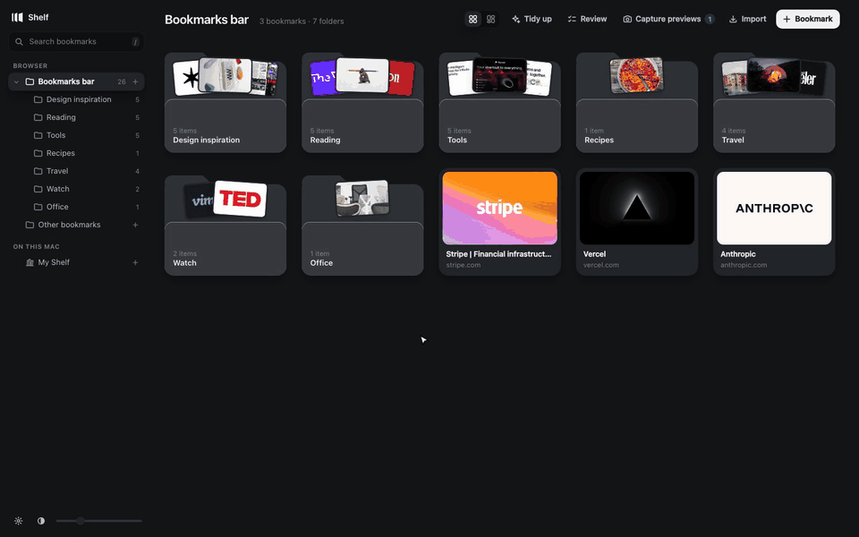

# Shelf: the bookmark manager Dia doesn't have

**Dia has bookmarks, but no real place to manage them. Shelf is that place.**

Shelf turns your bookmarks into a calm, visual canvas: every bookmark becomes a card with a live
preview, folders open in place, and you organise everything by dragging. It talks to the browser's
real bookmark store, so whatever you do in Shelf (rename, move, reorder, delete) is exactly what Dia's
bookmarks bar shows, and the other way round. No sync service, no account, no copy of your data
somewhere else.

Built for [Dia](https://www.diabrowser.com/), and made of nothing but standard Chrome extension APIs,
so it also runs in other Chromium browsers such as Chrome, Arc, Brave and Edge.



## Features

- **A canvas, not a list.** Bookmarks are cards with real previews (a screenshot of the page, or its
  own preview image) in a **grid** or an uncropped **gallery** view, with a size slider.
- **Quick Look.** Press `Space` or click a card and it zooms open into a live, scrollable preview of the
  page. YouTube and Vimeo play, X and Instagram posts show as the post itself, and images, video, audio
  and PDFs open in a viewer.
- **Drag everything.** Reorder, drop onto folders, sidebar folders or breadcrumbs, spring-load into
  folders while dragging, multi-select and move a whole stack. Nest and reorder folders in the sidebar.
- **Always in sync** with the browser's bookmarks, in both directions, via the `chrome.bookmarks` API.
- **Undo** for moves, deletes, adds, edits and notes.
- **Notes** on any bookmark (why you saved it), shown on the card and searchable.
- **Search** across everything with `/` or `⌘K`.
- **Review**: find broken links, duplicates, and bookmarks you haven't opened in months. Nothing is
  deleted until you tick it.
- **Tidy up**: proposes where loose bookmarks belong, shows the plan first, moves them in one undoable
  batch. Works fully on your device, or lets you copy a prompt to sort with Claude and import the plan.
- **My Shelf**: a second, local library for things browser bookmarks can't hold: drop in videos, images,
  PDFs, audio or any file, and they get thumbnails and open in Quick Look.
- **Import your saved posts** from X bookmarks, Instagram saved posts and Pinterest boards, with their
  pictures kept as previews. Later syncs only pick up what is new.
- **Project sessions**: open a folder as a new window or a named tab group; save all tabs of a window
  as a folder.
- **Safety net**: an automatic snapshot of your whole bookmark tree every day Shelf is opened and before
  every Tidy up, downloadable as a standard bookmarks `.html` file.
- Light and dark themes. No build step, no dependencies.

## Install

Shelf isn't on the Chrome Web Store yet, so you load it as an unpacked extension. It takes a minute.

### 1. Download

Grab **`shelf-vX.Y.Z.zip`** from the [latest release](../../releases/latest) and unzip it. You get a
folder with `manifest.json` at the top: that folder *is* the extension. Put it somewhere permanent
(e.g. `~/Applications/Shelf`), because the browser loads it from there every time it starts. If you
delete or move the folder, the extension disappears.

> Browsers can't install the `.zip` itself: unpacked extensions must be a folder. Unzip first.

Prefer git? `git clone https://github.com/OmarMota/shelf.git` and use the `extension/` folder.
Updating is then just `git pull` and a click on the reload arrow.

### 2. Load it in Dia

1. Open `dia://extensions`
2. Turn on **Developer mode** (top right)
3. Click **Load unpacked** and choose the unzipped folder (or `extension/` if you cloned)
4. Open it with the **Shelf** toolbar button, or `⌥⇧B`. It also registers itself as the
   bookmarks page, so `dia://bookmarks` should open Shelf instead of the built-in manager.

To update to a new release: download the new zip, replace the folder's contents, then hit the reload
arrow on Shelf's card in `dia://extensions`. Your notes, previews and settings are kept.

### Chrome, Arc, Brave, Edge and other Chromium browsers

Same steps, starting from the browser's extensions page (`chrome://extensions`,
`brave://extensions`, `edge://extensions`; in Arc, *Extensions → Manage extensions*).
Where the browser has its own bookmarks page (e.g. `chrome://bookmarks`), Shelf replaces it.
In browsers without tab groups, **Open all as a tab group** falls back to plain tabs.

> Shelf is developed and tested in Dia. It uses only standard Manifest V3 APIs, but if something
> behaves differently in your browser, please [open an issue](../../issues).

## Using it

| | |
|---|---|
| Click a bookmark | Quick Look: the card zooms open into a live, scrollable preview |
| Click a folder | Its contents fly out of the folder |
| Drag | Reorder, drop on a folder card, a sidebar folder, or a breadcrumb |
| Hover a folder while dragging | It springs open so you can drop deeper |
| Drag a **sidebar folder** | Onto another folder to nest it · onto the line *between* two rows to re-order it or pull it out to that level |
| Right-click → **Move out to "…"** | Sends a folder or bookmark one level up, right after the folder it was in |
| **+** on a sidebar folder | New folder inside it (always shown on Bookmarks bar, Other bookmarks and My Shelf) |
| `⌘`-click / `⇧`-click / drag on empty canvas | Multi-select, then drag the whole stack |
| Right-click | Open, edit, copy link, move to…, refresh preview, delete |
| `Space` | Quick Look the hovered / selected card · `←` `→` to flip through |
| `V` | Switch the folder between **grid** and **gallery** (pictures uncropped, in columns) |
| `⌘C` on a card | Copies its **image** to the clipboard (or its link, if it has no picture) |
| `E` | Edit · `N` note · `⌫` delete · `⌘Z` undo (moves, deletes, adds, edits, notes) |
| `/` or `⌘K` | Search everything · `⌘↑` parent folder · `⌘A` select all |
| Paste a URL, or drop a link/tab on the canvas | Adds a bookmark (title is fetched for you) |

### Keyboard shortcuts

| Key | Action |
|---|---|
| `⌥⇧B` | Open Shelf from anywhere (can be changed on the browser's extension shortcuts page) |
| `Space` | Quick Look · `←` `→` previous / next · `Enter` open in a tab · `Esc` close |
| `Enter` | Open the selected bookmarks, or enter the selected folder |
| Arrow keys | Move the selection between cards |
| `/` or `⌘K` | Search |
| `⌘↑` | Parent folder |
| `⌘A` · `Esc` | Select all · clear selection |
| `E` · `N` | Edit · add a note |
| `⌫` | Delete (undoable) |
| `⌘Z` | Undo |
| `⌘C` | Copy the card's image (or link) |
| `V` | Grid ⇄ gallery |

### Gallery view, and getting images out

The button left of **Tidy up** (or `V`) switches a folder to a gallery: every picture at its own
proportions, title on hover. Folders that are mostly pictures (pins, Instagram posts, image files) open
that way by themselves; your choice is remembered per folder.

Right-click a card with a picture → **Copy image** (`⌘C`) puts a PNG on the clipboard, ready for Figma,
Notes or a chat; **Save image…** downloads it. Shelf goes for the sharpest copy it can get (the file
itself, or the original behind a pin or post if its address still answers) and falls back to the
preview it keeps.

### Notes

Press `N` on a card (or right-click → **Add a note…**, or the Note field in Edit). The note replaces the
hostname on the card, shows in Quick Look, and is **searchable**. Notes are kept by address inside the
extension; they are not part of the browser's bookmark file or its backups.

### Project sessions

- Right-click a folder → **Open all in a new window** / **Open all as a tab group** (named after the
  folder).
- Right-click the canvas (or **Import**) → **Save this window's tabs as a folder…**: every web page open
  in the window becomes a bookmark in a new folder, e.g. `Session · 18 Sep`. One Undo removes it.

### Review: broken, duplicate, forgotten

**Review** (top bar) looks at all bookmarks, or only the current folder. Nothing is deleted until you
tick it and press **Delete**, and the usual Undo brings it back.

- **Broken links**: asks each site for the page (no cookies) and sorts the answers: *Gone* (404/410,
  ticked for you), *No answer* (dead domain), *Moved to another site* (✓ updates the address). Logins and
  bot walls count as "couldn't tell" and are left alone. Each row has a Wayback Machine lookup.
- **Duplicates**: same page ignoring `www`, `#…`, trailing `/` and tracking tags. Keeps the copy with
  your note, else the oldest.
- **Not opened**: saved more than 3 / 6 / 12 / 24 months ago and not opened in the last three months
  (browser history, the bookmarks bar's own "last used", and opens from Shelf). ♥ keeps one and stops
  asking for a year.

### Tidy up: sorting that reads the bookmark

**Tidy up** works out where bookmarks belong and shows the plan first. Nothing moves until you press
**Move**, you can untick anything, and one **Undo** reverses the whole batch (including folders it
created). A backup is saved before every run. There is no API key anywhere:

- **Sort on this Mac**: compares each loose bookmark's title, site, description and caption with what
  every folder already holds. Instant and private, but it can only use folders you already have.
- **Sort with Claude**, in three steps: **Copy prompt** puts a ready-made prompt on your clipboard with
  the bookmarks inside it; paste it into Claude (claude.ai or Claude Code), which answers with a plan;
  bring that back with **Paste answer** or **Choose file…**, then review. Plans are plain JSON:
  `{"shelfPlan":1,"moves":[{"id":"123","url":"https://…","to":["Bookmarks bar","Design","Icons"],"reason":"…"}]}`.
  `to` is a folder path by name; missing folders are created. Items are matched by id, then by url.
  A local `plans/` folder is gitignored if you want to keep plan files next to the code.

**Settings → "File new Instagram and X bookmarks into their own folders"** (off by default): 20 seconds
after you bookmark a post into a top-level folder, it is moved to `Instagram` / `X (Twitter)`.

### My Shelf: your own library

Browser bookmarks can only hold addresses, so Shelf adds a second tree, **My Shelf**, that lives inside
the extension:

- **Drop in files** (or use **Files**, or paste): videos, images, PDFs, audio, text. They are stored
  locally, get a thumbnail, and open in Quick Look. Right-click → **Download** gets the original back.
- **Save links** there too, with folders, drag & drop, search and undo exactly like bookmarks.
- Drag a browser bookmark onto My Shelf (or back) to move it between the two.
- Right-click a direct link to a video / image / PDF → **Save a local copy to My Shelf**.

### Your saved posts from X, Instagram and Pinterest

**Import** → **My X bookmarks…** / **My Instagram saved posts…** / **My Pinterest boards and pins…**.
Shelf opens the site in a normal tab (your own login, untouched) and shows a small panel:

1. If you aren't on your saved list yet, the panel says so and offers to go there. It reads nothing on
   other pages unless you press **Use this page**.
2. On the list, it counts posts as they appear while you scroll (or press **Auto-scroll**).
3. **Save to Shelf** files them under `My Shelf / X bookmarks`, `My Shelf / Instagram saved` or
   `My Shelf / Pinterest / <board>`, with the post text as title and a copy of each picture as the
   preview (those image addresses expire). Posts you already have are skipped.

Once you've imported, the menu says **Sync my X bookmarks… · 3d ago**, and Auto-scroll stops as soon as
it only finds posts from an earlier import. It only reads links and images the page is already showing
you: no password, cookie or token is read. Instagram's official export works too: drop
`saved_posts.json` onto My Shelf (links only, no pictures).

## Privacy

Shelf has **no server, no account, no analytics and no tracking**. Your bookmarks, notes, previews,
files and backups stay in your browser.

- **What it accesses:** your bookmarks (to show and edit them), your history (only for Review → *Not
  opened*), your tabs (sessions, and to refresh a preview when you visit a bookmarked page; this can be
  turned off in Settings), and, only when you start an import, the X / Instagram / Pinterest page you
  opened.
- **What goes over the network:** requests from your browser straight to the sites you bookmarked (to
  get titles and preview images, and to check links), public embed endpoints for YouTube, Vimeo, X and
  Instagram posts, and the pages shown in Quick Look. Shelf's own requests are sent without cookies or
  referrer. Favicons come from the browser's built-in cache.
- **Sort with Claude** only copies a prompt to your clipboard. Nothing is sent unless you paste it.

The full, precise list is in **[PRIVACY.md](PRIVACY.md)**.

## How it works

Shelf is a Manifest V3 extension. The browser's bookmark store is the source of truth: Shelf reads it
through `chrome.bookmarks`, writes every change back through the same API, and listens to its events so
edits made elsewhere (for example on Dia's bookmarks bar) appear right away.

```
extension/
├── manifest.json        permissions, bookmarks-page override, ⌥⇧B command
├── background.js        service worker: opens Shelf, refreshes previews on visit,
│                        auto-files social posts, drives the import panel
├── index.html, app.css  the Shelf page
├── view.html            viewer for files kept in My Shelf
├── icons/               16, 32, 48, 128 px
└── js/
    ├── app.js           the canvas, sidebar, drag & drop, selection, menus, keyboard
    ├── model.js         one tree over two sources: browser bookmarks + My Shelf
    ├── local.js         My Shelf (IndexedDB), mirrors the chrome.bookmarks API
    ├── db.js            IndexedDB: previews, My Shelf items and files, backups
    ├── previews.js      metadata/preview fetch queue and cache
    ├── quicklook.js     live previews and screenshot capture
    ├── netrules.js      session-only header rules so pages render inside Quick Look
    ├── media.js         recognises YouTube, Vimeo, X, Instagram, Pinterest, files
    ├── review.js        broken links, duplicates, not opened
    ├── tidy.js          Tidy up: on-device sorting, Claude prompt, plan import
    ├── backup.js        daily and pre-Tidy snapshots, export to bookmarks .html
    ├── collector.js     the import panel injected into X / Instagram / Pinterest
    ├── social-import.js files imported posts into My Shelf
    ├── notes.js         notes and "last opened" marks (chrome.storage)
    └── ui.js, util.js, img.js, view.js, ruleids.js   helpers
```

## Development

No build step, no dependencies, no package manager: the `extension/` folder *is* the extension.

1. Load it unpacked as described in [Install](#install).
2. Edit any file.
3. Hit the reload arrow on the Shelf card in `dia://extensions` (or your browser's extensions page),
   then reopen Shelf.

To debug, right-click in Shelf → **Inspect**, or click **service worker** on the extension card for
`background.js`. See [CONTRIBUTING.md](CONTRIBUTING.md) for guidelines.

## Roadmap

- [ ] Chrome Web Store release (coming)
- [ ] Demo GIF and screenshots
- [ ] More ideas welcome: [open an issue](../../issues)

## Inspiration

The idea of bookmarks as a calm, spatial canvas is inspired by [Spatial](https://www.get-spatial.com/).
Shelf is an independent project and is not affiliated with Spatial or with The Browser Company.

## Contributing

Issues and pull requests are welcome. Please read [CONTRIBUTING.md](CONTRIBUTING.md) first. The short
version: plain JS/HTML/CSS, no dependencies, privacy first, and never commit your own bookmarks.

## License

[MIT](LICENSE) © 2026 Omar Mota
